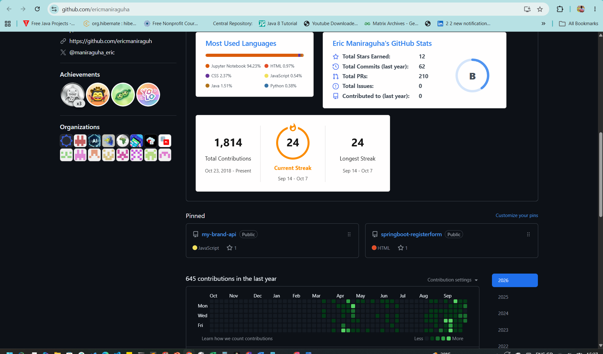
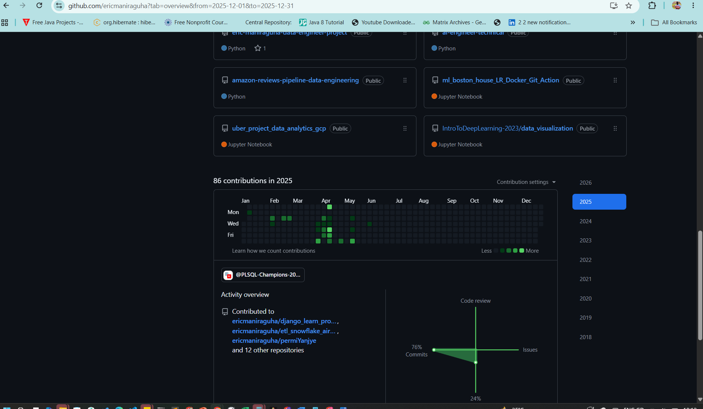
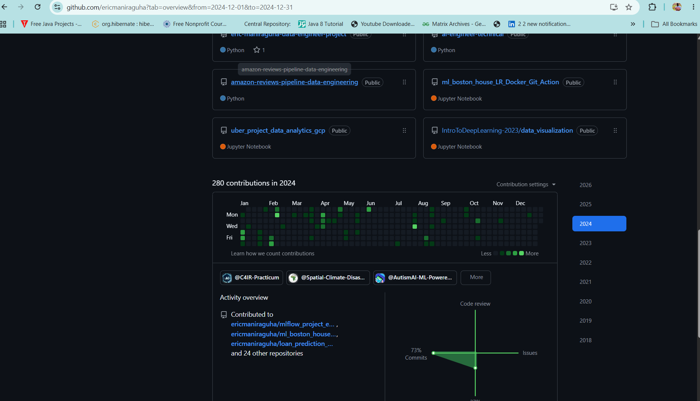
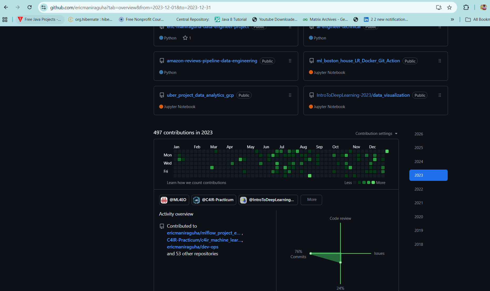

<div align="center">

# Eric Maniraguha
### Data Engineer · Database & Analytics Engineer · Data Engineering Consultant

**Project Contributions & Technical Portfolio**

📍 Kigali, Rwanda · ✉️ [ericmaniraguha@gmail.com](mailto:ericmaniraguha@gmail.com) · 📞 +250 788 746 696

[](https://linkedin.com/in/ericmaniraguha)
[](https://github.com/ericmaniraguha)
[](https://github.com/ericmaniraguh)
[](https://orcid.org/0009-0006-3219-258X)

`SQL` `PostgreSQL` `Oracle PL/SQL` `MySQL` `Python` `PySpark` `Apache Airflow` `dbt` `Kafka` `Power BI` `Grafana` `Docker` `AWS`

</div>

---

## Contents

1. [Professional Summary](#professional-summary)
2. [Impact at a Glance](#impact-at-a-glance)
3. [Confidentiality: Why Most Code Lives Elsewhere](#confidentiality-why-most-code-lives-elsewhere)
4. [Career-to-Project Map](#career-to-project-map)
5. [Project Case Studies](#project-case-studies)
6. [Public Repositories](#public-repositories)
7. [Code Samples](#code-samples)
8. [Skills Alignment](#skills-alignment)
9. [Technical Skills](#technical-skills)
10. [Education & Certifications](#education--certifications)
11. [GitHub Contribution History](#github-contribution-history)
12. [Evidence & Sanitization Policy](#evidence--sanitization-policy)

---

## Professional Summary

Data Engineer and Database/Analytics professional with **10+ years of experience** designing data systems, ETL/ELT pipelines, relational databases, BI solutions, and digital transformation initiatives across **fintech, healthcare, humanitarian, research, and public-sector** environments. **MSc in Information Technology (Data Science & Machine Learning) from Carnegie Mellon University Africa.**

I help organizations turn fragmented operational data into **reliable, governed, decision-ready systems**, covering the full lifecycle:

> **Data modelling → Pipeline design → Data quality & reconciliation → Performance tuning → Dashboards & monitoring → Documentation & handover**

---

## Impact at a Glance

| Result | Context |
|:-------|:--------|
| **98%** data consistency across integrated datasets | Validation, reconciliation & quality controls, Dussoft Engineering |
| **23%** improvement in operational efficiency | Automated pipeline scheduling, error handling & logging, Dussoft Engineering |
| **13%** reduction in data processing time | Pipeline automation & performance tuning, Dussoft Engineering |
| **90+** operational units supported | Financial & business database systems, BrightSeed Hub |
| **18,200**-record Golden Employee Dataset; **30** potential ghost employees flagged | HR Data Integration Pipeline (entity resolution & data quality) |
| **8** business domains unified in one ERP data platform | Sales, inventory, HR, payroll, finance, assets, bookings, customers, DRA VANUA |

---

## Confidentiality: Why Most Code Lives Elsewhere

Most of my professional work was delivered **for client and partner organizations**. Their source code, data, and repositories are **private and owned by them**, so I don't link to or republish them. This repository presents that work responsibly:

| ✅ What you'll find here | ❌ What you won't find here |
|:------------------------|:---------------------------|
| Case studies: context, problem, my role, architecture, outcome | Proprietary source code or private repository links |
| Sanitized architecture and data-flow diagrams | Real customer, patient, or financial data |
| Original, runnable SQL I wrote to demonstrate the same techniques | Credentials, connection strings, or internal hostnames |
| Links to my own **public** project repositories | Client-confidential metrics or documents |
| Multi-year GitHub contribution history | |

> 💬 **Happy to go deeper in an interview:** live walkthroughs of designs, schema decisions, and trade-offs, plus references from the organizations involved, on request.

---

## Career-to-Project Map

How each role on my CV connects to the evidence in this repository.

| Period | Organization | Role | Evidence in this repo |
|:-------|:-------------|:-----|:----------------------|
| Nov 2025 – Present | **BrightSeed Hub Ltd.** | Database Engineering & Systems Analyst Consultant | [Case study](./case-studies/BrightSeed-Hub/) |
| Jul 2026 – Oct 2026 | **eFiche** | Digital Health Implementation Consultant | [Case study](./case-studies/eFiche-EHR-Migration/) |
| 2026 | **DRA VANUA Group Ltd** | ERP Data Engineering & Systems Development (project lead) | [Case study](./case-studies/DRA-VANUA-ERP/) · [Repository](#public-repositories) |
| May 2023 – Nov 2025 | **Dussoft Engineering** | Data Engineering & Database Systems Consultant / Technical Focal Person | [Case study](./case-studies/Dussoft-Engineering/) |
| Jun 2023 – Dec 2025 | **CyLab Africa / Upanzi Network** | Research Associate: Data Scientist & ICT Systems Analyst | [Upanzi Mojaloop](./case-studies/Upanzi-Mojaloop/) · [CyLab Africa](./case-studies/CyLab-Africa/) |
| Aug 2023 – Dec 2023 | **C4IR Rwanda** | AI Developer | [AI Document Navigator](./case-studies/C4IR-Document-Navigator/) |
| Jul 2019 – Sep 2022 | **Dussoft Engineering** | Data Engineer & Team Lead | [Humanitarian Market Intelligence](./case-studies/Humanitarian-Market-Intelligence/) |
| Apr 2015 – May 2019 | **Tech-Connect Business Park** | ICT Systems & E-Business Solutions Consultant (Lusaka) | [Case study](./case-studies/Tech-Connect-Business-Park/) |
| Sep 2024 – Present | **AUCA** (and UNILAK, University of Kigali) | Assistant Lecturer: Oracle PL/SQL, Big Data Analytics, MIS | [Code samples](#code-samples) used as teaching-grade examples |

---

## Project Case Studies

Each case study follows the same consulting format: **Context → Problem → What I Delivered → Architecture → Impact → Technologies.**

### 💳 Fintech & Payments

| Project | My Data Engineering Contribution | Core Technologies |
|:--------|:---------------------------------|:------------------|
| [**Upanzi Network: Mojaloop**](./case-studies/Upanzi-Mojaloop/)<br><sub>Digital Public Infrastructure · payment switch</sub> | Multi-currency ledger data model; reporting dashboards; Grafana observability & log tracking; SQL optimization and indexing | PostgreSQL, MySQL, Grafana, Loki, Prometheus, Node.js |
| [**FinTech Core & Payment Engine**](./case-studies/FinTech-Core-Banking-Engine/)<br><sub>Financial services · payments</sub> | Double-entry ledger schema; automated settlement **reconciliation pipelines**; data integrity controls | PostgreSQL, Redis, RabbitMQ/BullMQ, Docker |
| [**BrightSeed Hub**](./case-studies/BrightSeed-Hub/)<br><sub>Financial & business applications · 90+ units</sub> | Schema, stored procedure & index optimization; migration, cleansing & reconciliation; automated data quality checks; Grafana monitoring; RBAC, backup & recovery | PostgreSQL, SQL, Python, Grafana |

### 🏥 Healthcare

| Project | My Data Engineering Contribution | Core Technologies |
|:--------|:---------------------------------|:------------------|
| [**eFiche: EHR Data Migration**](./case-studies/eFiche-EHR-Migration/)<br><sub>Digital health · electronic health records</sub> | Led data migration & database implementation; validation, transformation & integrity checks; SQL troubleshooting; ETL and interoperability support; English–French localization | SQL, ETL, data validation, REST APIs |
| [**GeoScalable Malaria Surveillance**](./case-studies/Malaria-Surveillance-Analytics/)<br><sub>Kamabuye Health Center · 2024–2025</sub> | Geospatial data pipelines and GIS dashboards for malaria hotspot analysis | MongoDB, PostgreSQL, Airflow, Django, Elasticsearch, Kibana |

### 🏛️ Public Sector, Research & AI

| Project | My Data Engineering Contribution | Core Technologies |
|:--------|:---------------------------------|:------------------|
| [**CyLab Africa**](./case-studies/CyLab-Africa/)<br><sub>Cybersecurity & DPI research</sub> | Security **telemetry ingestion pipeline**; event categorization for threat analytics; data platform administration and governance | Python, PySpark, PostgreSQL, Elasticsearch, CI pipelines |
| [**AI-Powered Document Navigator**](./case-studies/C4IR-Document-Navigator/)<br><sub>C4IR Rwanda · government information retrieval</sub> | NLP/LLM ingestion pipeline: cleansing, chunking, embeddings; vector storage, metadata & similarity search; RAG over REST APIs | Python, LLMs, vector databases, REST APIs |

### 🏢 Enterprise, ERP & Supply Chain

| Project | My Data Engineering Contribution | Core Technologies |
|:--------|:---------------------------------|:------------------|
| [**DRA VANUA ERP Platform**](./case-studies/DRA-VANUA-ERP/)<br><sub>Led end-to-end · 2026</sub> | MySQL data platform integrating 8 business domains; Sequelize migrations; RBAC & audit logging; ETL, BI & KPI dashboards; Grafana monitoring; Dockerized deployment | MySQL, Node.js, Sequelize, Grafana, Docker |
| [**Dussoft Engineering**](./case-studies/Dussoft-Engineering/)<br><sub>Technical focal person · 2023–2025</sub> | Oracle/PostgreSQL/MySQL administration; Airflow ETL with validation & reconciliation; migration, backup & recovery; runbooks; Power BI & Kibana dashboards | Oracle, PL/SQL, PostgreSQL, MySQL, Python, Airflow, Power BI, Kibana |
| [**Humanitarian Market Intelligence**](./case-studies/Humanitarian-Market-Intelligence/)<br><sub>Dussoft · 2019–2022</sub> | Multi-source ETL/ELT into PostgreSQL; dedup & schema validation; automated quality checks; food-price and supply-chain Power BI dashboards | PostgreSQL, Python, Pandas, Airflow, AWS S3, Redshift, Power BI |
| [**Tech-Connect Business Park**](./case-studies/Tech-Connect-Business-Park/)<br><sub>Lusaka · 2015–2019</sub> | Database design & administration; e-payment and transaction workflows; RBAC data access design; system integration and data quality controls | SQL, relational databases, e-payment integrations |

---

## Public Repositories

Projects I own end-to-end, with source code available.

| Repository | What it demonstrates | Highlights |
|:-----------|:---------------------|:-----------|
| [**DRA VANUA ERP**](https://github.com/ericmaniraguha/REPLACE-WITH-REPO) | Full ERP data platform: schema design, migrations, RBAC, audit logging, Grafana | 8 integrated domains, Dockerized, automated DB migrations |
| [**HR Data Integration Pipeline**](https://github.com/ericmaniraguha/REPLACE-WITH-REPO) | Python ETL over CSV, JSON, XLSX & XML; schema harmonization; entity resolution | 18,200-record golden dataset, 30 ghost employees flagged, automated tests |
| [**Humanitarian Market Dashboard**](https://REPLACE-WITH-DASHBOARD-LINK) | Published Power BI results | Food-price monitoring & market trends |

---

## Code Samples

Because client code can't be shared, these samples were **written from scratch** to demonstrate the techniques I apply on client projects and teach in Oracle PL/SQL and Advanced Database courses. All target **PostgreSQL 15+**.

| # | Section | What it demonstrates | Technologies |
|:--|:--------|:---------------------|:-------------|
| 01 | [**Database Administration**](./code-samples/01-database-administration/) | Schema design with constraints, views & materialized views, stored procedures, functions, audit triggers, role hierarchy, **row-level security**, monitoring queries | PostgreSQL, PL/pgSQL |
| 02 | [**Performance Tuning**](./code-samples/02-performance-tuning/) | End-to-end slow-query case study: identify → `EXPLAIN ANALYZE` → index → rewrite → verify; CTEs, window functions, database statistics | PostgreSQL, pg_stat_statements |

**Quick start**

```bash
createdb portfolio_demo
psql -d portfolio_demo -f code-samples/01-database-administration/schemas/<schema-file>.sql
```

---

## Skills Alignment

| Competency | Where it's shown |
|:-----------|:-----------------|
| **Data modelling** (relational, ledger, multi-tenant, ERP) | [Upanzi Mojaloop](./case-studies/Upanzi-Mojaloop/), [FinTech ARCHITECTURE.md](./case-studies/FinTech-Core-Banking-Engine/ARCHITECTURE.md), [DRA VANUA ERP](./case-studies/DRA-VANUA-ERP/), [schemas/](./code-samples/01-database-administration/schemas/) |
| **ETL/ELT pipelines & orchestration** | [Dussoft Engineering](./case-studies/Dussoft-Engineering/), [Humanitarian Market Intelligence](./case-studies/Humanitarian-Market-Intelligence/), [CyLab telemetry pipeline](./case-studies/CyLab-Africa/) |
| **Data migration & reconciliation** | [eFiche EHR migration](./case-studies/eFiche-EHR-Migration/), [FinTech reconciliation workers](./case-studies/FinTech-Core-Banking-Engine/), [BrightSeed Hub](./case-studies/BrightSeed-Hub/) |
| **Data quality & entity resolution** | [HR Data Integration Pipeline](#public-repositories), [triggers & constraints](./code-samples/01-database-administration/schemas/) |
| **Query optimization & performance** | [02-performance-tuning](./code-samples/02-performance-tuning/), [Upanzi reporting optimization](./case-studies/Upanzi-Mojaloop/) |
| **Analytics, BI & dashboards** | [Humanitarian dashboards](./case-studies/Humanitarian-Market-Intelligence/), [Upanzi Grafana](./case-studies/Upanzi-Mojaloop/), [DRA VANUA KPI reporting](./case-studies/DRA-VANUA-ERP/) |
| **Data security & access control** | [roles-and-permissions/](./code-samples/01-database-administration/roles-and-permissions/), [FinTech compliance doc](./case-studies/FinTech-Core-Banking-Engine/docs/compliance-and-security.md) |
| **Monitoring & observability** | [monitoring/](./code-samples/01-database-administration/monitoring/), [BrightSeed Grafana](./case-studies/BrightSeed-Hub/), [Upanzi Grafana & Loki](./case-studies/Upanzi-Mojaloop/) |
| **AI/ML & LLM data pipelines** | [C4IR Document Navigator](./case-studies/C4IR-Document-Navigator/), [Malaria surveillance](./case-studies/Malaria-Surveillance-Analytics/) |
| **Documentation & handover** | Every case study and section README; runbooks described in [Dussoft Engineering](./case-studies/Dussoft-Engineering/) |
| **Sustained hands-on engineering** | [GitHub contribution history](#github-contribution-history) |

---

## Technical Skills

| Area | Tools & Practices |
|:-----|:------------------|
| **Databases** | PostgreSQL, Oracle & PL/SQL, MySQL, SQL Server, MongoDB, Elasticsearch, Amazon Redshift: modelling, procedures, triggers, indexing, query optimization, capacity planning |
| **Data Engineering** | Python, PySpark, Pandas, ETL/ELT, Apache Airflow, Kafka, dbt, data lakes, data warehousing |
| **Reliability & Operations** | Monitoring, health checks, backup & recovery, DR, replication, migration, patching, incident troubleshooting, runbooks |
| **Governance & Security** | RBAC, row-level security, auditing, data quality, metadata management, compliance controls |
| **Monitoring & BI** | Grafana, Kibana, Prometheus, Loki, Power BI, SQL analytics |
| **AI & ML** | Scikit-learn, TensorFlow, deep learning, LLMs, RAG, embeddings, vector databases |
| **Cloud & DevOps** | AWS (S3, Redshift), Docker, Kubernetes, CI/CD, MLOps |
| **GIS** | ArcGIS Pro, Google Earth Engine, spatial analytics |

---

## Education & Certifications

**Education**
- **MSc Information Technology (Data Science & Machine Learning)**, Carnegie Mellon University Africa, 2021–2024 · GPA 3.60
- **BSc Information Management**, Chreso University (with North End State University College), 2013–2017 · Merit

**Certifications**
- Data Engineer Certification, DataCamp
- SQL Associate Certification, DataCamp (valid to Sep 2028)
- Big Data Fundamentals with PySpark, DataCamp (Oct 2026)
- Kubernetes and Cloud Native Associate (KCNA), Linux Foundation
- Full-Stack Developer Certification, Andela Rwanda
- 15+ additional certifications in AI/ML, data governance, databases, statistics, and FinTech

---

## GitHub Contribution History

Much of my day-to-day work happens in **private organizational repositories**, so these graphs show activity that the public repositories alone don't reflect.

<details open>
<summary><b>2026</b></summary>


</details>

<details>
<summary><b>2025</b></summary>


</details>

<details>
<summary><b>2024</b></summary>


</details>

<details>
<summary><b>2023</b></summary>


</details>

---

## Evidence & Sanitization Policy

- **Code samples** in [`code-samples/`](./code-samples/) are my **original work**, written for this portfolio.
- **Case studies** in [`case-studies/`](./case-studies/) describe work delivered for organizations. Diagrams and screenshots are **sanitized**: no proprietary code, credentials, personal data, or confidential identifiers.
- **Metrics** quoted here are the same figures stated on my CV and can be discussed in detail at interview.
- Organization names are used only to give context for my role. All rights to the underlying systems belong to their owners.

---

<div align="center">

**Eric Maniraguha** · Data Engineering Consultant

✉️ [ericmaniraguha@gmail.com](mailto:ericmaniraguha@gmail.com) · 📍 Kigali, Rwanda

[LinkedIn](https://linkedin.com/in/ericmaniraguha) · [GitHub](https://github.com/ericmaniraguha) · [ORCID](https://orcid.org/0009-0006-3219-258X)

</div>
