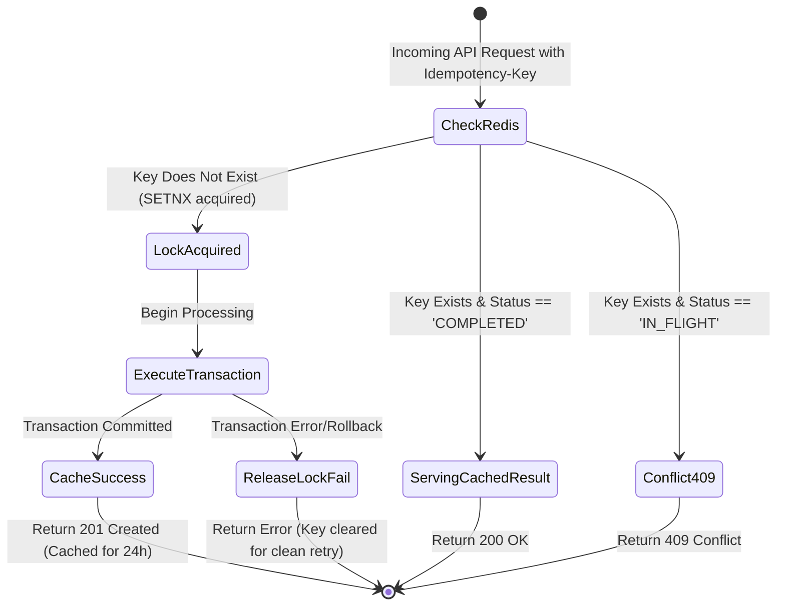

# 🏛️ Financial Architecture & Ledger Data Model

This document outlines the architectural specifications, transaction consistency mechanisms, and database models designed for the **FinTech Core & Payment Engine**.

---

## 1. Double-Entry Accounting Model

In financial accounting, every economic event represents an exchange of value. Value is never created or destroyed; it is moved from one account classification to another:

$$\sum \text{Debits} = \sum \text{Credits}$$

### Account Classification Model
- **Assets (Normal Debit):** Cash held in bank accounts, escrow, reserve accounts.
- **Liabilities (Normal Credit):** Customer balances held, merchant payables.
- **Equity (Normal Credit):** Retained earnings, capital.
- **Revenue (Normal Credit):** Processing fees earned, interchange revenue.
- **Expenses (Normal Debit):** Interchange fees paid, SMS gateway costs, payment rail charges.

### Core Database DDL (PostgreSQL)

```sql
-- 1. Accounts Table
CREATE TABLE ledger_accounts (
    id UUID PRIMARY KEY DEFAULT gen_random_uuid(),
    account_number VARCHAR(32) NOT NULL UNIQUE,
    account_type VARCHAR(20) NOT NULL CHECK (account_type IN ('ASSET', 'LIABILITY', 'EQUITY', 'REVENUE', 'EXPENSE')),
    currency VARCHAR(3) NOT NULL DEFAULT 'RWF', -- ISO 4217 Currency
    status VARCHAR(16) NOT NULL DEFAULT 'ACTIVE' CHECK (status IN ('ACTIVE', 'FROZEN', 'CLOSED')),
    created_at TIMESTAMPTZ NOT NULL DEFAULT NOW(),
    updated_at TIMESTAMPTZ NOT NULL DEFAULT NOW()
);

-- 2. Journal Entry Table (Represents a single atomic financial event)
CREATE TABLE journal_entries (
    id UUID PRIMARY KEY DEFAULT gen_random_uuid(),
    reference_id VARCHAR(64) NOT NULL UNIQUE, -- Unique business reference / payment ID
    idempotency_key VARCHAR(128) NOT NULL UNIQUE,
    entry_type VARCHAR(32) NOT NULL, -- e.g., 'PAYMENT_CAPTURE', 'FEE_ASSESSMENT', 'SETTLEMENT'
    description TEXT NOT NULL,
    posted_at TIMESTAMPTZ NOT NULL DEFAULT NOW(),
    created_at TIMESTAMPTZ NOT NULL DEFAULT NOW()
);

-- 3. Ledger Lines Table (Immutable postings)
CREATE TABLE ledger_lines (
    id UUID PRIMARY KEY DEFAULT gen_random_uuid(),
    journal_entry_id UUID NOT NULL REFERENCES journal_entries(id) ON DELETE RESTRICT,
    account_id UUID NOT NULL REFERENCES ledger_accounts(id) ON DELETE RESTRICT,
    entry_direction VARCHAR(6) NOT NULL CHECK (entry_direction IN ('DEBIT', 'CREDIT')),
    amount_cents BIGINT NOT NULL CHECK (amount_cents > 0), -- Stored in minor currency units (cents)
    created_at TIMESTAMPTZ NOT NULL DEFAULT NOW()
);

-- Indexing for high-performance balance queries
CREATE INDEX idx_ledger_lines_account_created ON ledger_lines (account_id, created_at DESC);
CREATE INDEX idx_ledger_lines_journal ON ledger_lines (journal_entry_id);
```

---

## 2. Concurrency Control & Deadlock Prevention

When transferring funds from Account A to Account B, concurrent transactions (e.g. A -> B and B -> A simultaneously) can cause circular wait deadlocks if locks are acquired in arbitrary order.

### Canonical Ordering Lock Strategy
To guarantee deadlock-free database operations, accounts are **always locked in alphabetical/lexicographical order of their IDs**:

```typescript
async function transferFunds(sourceAccountId: string, targetAccountId: string, amountCents: bigint) {
  // 1. Sort account IDs to prevent circular deadlocks
  const [firstLockId, secondLockId] = [sourceAccountId, targetAccountId].sort();

  return await db.transaction(async (trx) => {
    // 2. Acquire row-level locks strictly in sorted order
    const firstAccount = await trx('ledger_accounts')
      .where({ id: firstLockId })
      .forUpdate()
      .first();

    const secondAccount = await trx('ledger_accounts')
      .where({ id: secondLockId })
      .forUpdate()
      .first();

    // 3. Verify balance sufficiency for source account
    const currentBalance = await calculateBalance(trx, sourceAccountId);
    if (currentBalance < amountCents) {
      throw new InsufficientFundsError('Available balance below required amount');
    }

    // 4. Insert Journal Entry & Atomic Debit/Credit Ledger Lines
    const [entry] = await trx('journal_entries').insert({ ... }).returning('*');
    await trx('ledger_lines').insert([
      { journal_entry_id: entry.id, account_id: sourceAccountId, entry_direction: 'DEBIT', amount_cents: amountCents },
      { journal_entry_id: entry.id, account_id: targetAccountId, entry_direction: 'CREDIT', amount_cents: amountCents }
    ]);
  });
}
```

---

## 3. Idempotency State Machine



---

## 4. Reconciliation Engine Flow

Daily automated jobs cross-reference external settlement statements with the internal ledger:

1. **Ingestion:** Parse MT940 / CSV statements from external payment gateways (MTN MoMo, Airtel Money, Stripe).
2. **Deterministic Matching:** Match external transaction IDs against `journal_entries.reference_id`.
3. **Variance Evaluation:** Check:
   - Does `amount_cents` match exactly?
   - Does timestamp fall within acceptable settlement window?
   - Are gateway fee deductions precisely recorded?
4. **Exception Handling:** Unmatched items are flagged to an `unreconciled_items` exception queue for human investigation.
