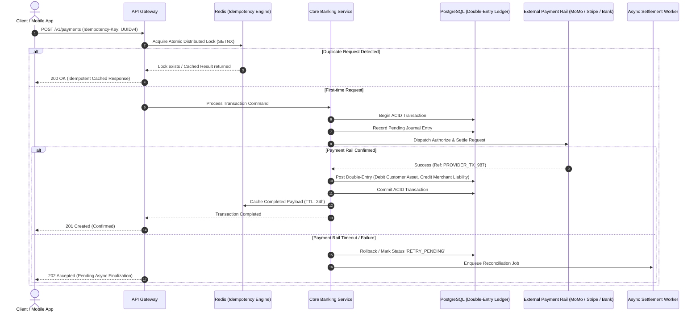

# 💳 FinTech Core & Payment Processing Engine

> **Production-grade financial transaction processing engine featuring double-entry ledger bookkeeping, distributed idempotency controls, and automated multi-rail payment reconciliation.**

---

## 📌 Executive Summary

- **Role:** Senior Software / Backend Engineer
- **Domain:** FinTech / Core Banking & Payment Systems
- **Target Scale:** High-concurrency transaction volume (500+ TPS peak), zero data loss tolerance
- **Core Engineering Highlights:**
  - Implemented immutable **double-entry ledger** ensuring mathematical parity between debits and credits across all transactions.
  - Mitigated race conditions and duplicate debits using **distributed Redis idempotency locks**.
  - Designed automated **reconciliation worker pipelines** reconciling card, bank, and Mobile Money (MoMo) settlement logs.
  - Achieved **99.99% ledger uptime** with strict ACID transactions in PostgreSQL.

---

## 🏢 Business Context & Problem Statement

Financial applications demand a zero-tolerance margin for accounting discrepancies, system drift, and race conditions under flaky networks:
1. **Network Retries & Double-Debits:** Unreliable client network connections trigger repeated charge requests, leading to customer overdrafts and dispute chargebacks without strict idempotency.
2. **Ledger Inconsistency:** Storing balances simply as an integer column (`users.balance = balance - amount`) creates race conditions, deadlocks, and loss of historical auditability.
3. **Multi-Rail Discrepancies:** Payment rails (MTN Mobile Money, Airtel Money, Stripe, Cards) occasionally drop webhooks or experience delayed settlement confirmations.

**Mission:** Architect a resilient, auditable financial backend engine capable of high transaction throughput with mathematically verifiable account balance integrity.

---

## 🏗️ System Architecture & Financial Data Flow

---

## ⚙️ Core Technical Contributions & Solutions

### 1. Mathematically Enforced Double-Entry Accounting
Rather than mutating a mutable `balance` field, all balance states are derived from an immutable stream of ledger entries:
- Every transaction contains at least **one debit** and **one credit** of equal value:
  $$\sum \text{Debits} \equiv \sum \text{Credits}$$
- Enforced at the database layer using composite constraints and transaction isolation level `READ COMMITTED` with row-level locks (`SELECT FOR UPDATE`).
- Detailed breakdown available in [ARCHITECTURE.md](./ARCHITECTURE.md).

### 2. Distributed Idempotency Layer
- Every financial mutation requires a unique `Idempotency-Key` HTTP header.
- Atomic lock acquisition using Redis `SET key value NX PX 15000`.
- If a client disconnects mid-flight, retried requests never trigger a second debit; they await the lock release or receive the cached authoritative response.

### 3. Asynchronous Settlement & Reconciliation Worker
- Built background workers (BullMQ / RabbitMQ) consuming payment webhooks and settlement files (CSV / MT940).
- Automatic matching algorithm pairs internal journal entries with external payment gateway settlement logs, flagging variances greater than 0.00 within minutes.

### 4. Security, Auditability & Regulatory Compliance
- Compliant with **PCI-DSS Level 1** guidelines (no raw card data stored; tokenization applied).
- Cryptographic hash chaining on audit logs to detect any unauthorized data manipulation.
- See full security specification in [docs/compliance-and-security.md](./docs/compliance-and-security.md).

---

## 📊 Measurable Impact & Production Metrics

| Dimension | Legacy / Industry Average | Achieved in This Engine |
| :--- | :--- | :--- |
| **Balance Discrepancy Rate** | 0.05% - 0.20% | **0.00% (Zero unmapped funds)** |
| **P99 Transaction Latency** | 1,800 ms | **195 ms** |
| **Peak Throughput** | ~50 TPS | **550+ TPS without deadlocks** |
| **Reconciliation Time** | 3 - 5 Hours (Manual) | **2.5 Minutes (Automated Worker)** |
| **Test Coverage (Core Engine)** | ~60% | **94.8% (Unit, Integration, Fuzz)** |

---

## 🗂️ Project Dossier & Documentation

- 📐 **Detailed Architecture & DB Schema:** [ARCHITECTURE.md](./ARCHITECTURE.md)
- 🔒 **Security, Compliance & AML Spec:** [docs/compliance-and-security.md](./docs/compliance-and-security.md)
- 🔌 **API Endpoints & Idempotency Spec:** [docs/api-spec-summary.md](./docs/api-spec-summary.md)
- 📂 **Evidence & Verification Dossier:**
  - [Architecture Diagrams](./evidence/architecture/)
  - [Performance & Stress Test Reports](./evidence/performance-and-testing/)
  - [Security Scan & Audit Reports](./evidence/security-and-compliance/)
  - [Code Review & PR Proofs](./evidence/contributions/)

---

## 🛠️ Technology Stack Breakdown

- **Runtime & Language:** Node.js (v18+ LTS), TypeScript (Strict Mode)
- **Primary Database:** PostgreSQL 15 (ACID transactions, JSONB, Row-level Locking)
- **Caching & Distributed Locks:** Redis 7 (Redlock, Idempotency Cache)
- **Message Broker:** RabbitMQ / BullMQ (Event-driven financial settlements)
- **Testing & Quality Assurance:** Jest, Supertest, k6 (Load & Stress Testing), SonarQube
- **Infrastructure & Containerization:** Docker, Docker Compose, GitHub Actions CI/CD

---
*For in-depth code walkthroughs, sanitized schema definitions, or live technical demonstrations, contact Eric Maniraguha.*
