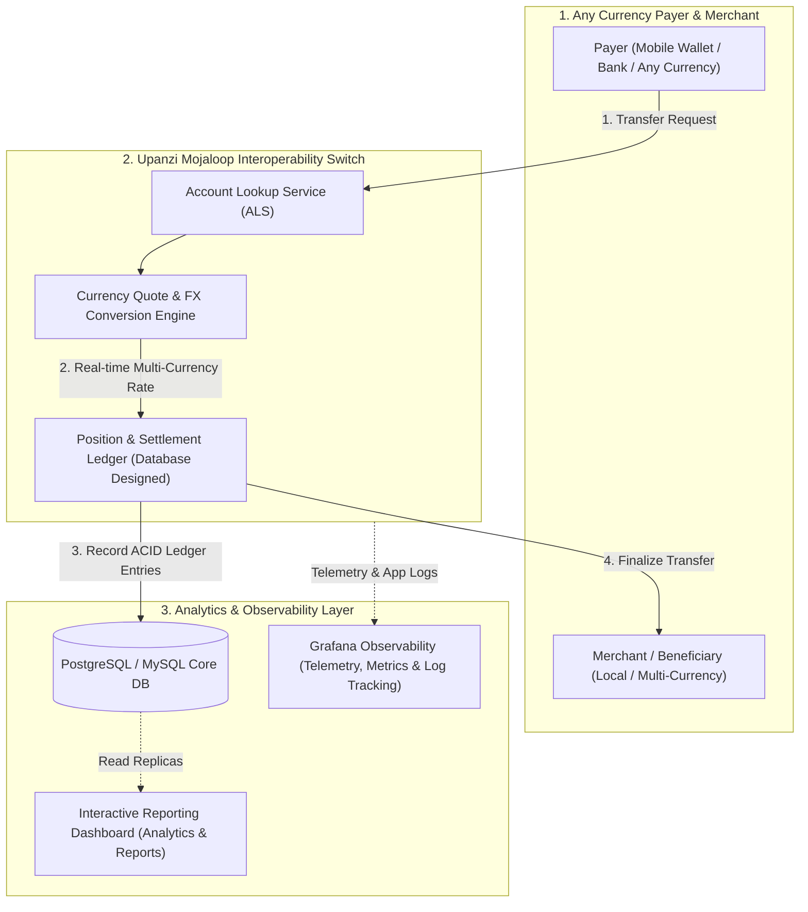

# 🌍 Upanzi Network — Mojaloop Digital Currency Inclusion Project

> **Open, interoperable digital payment switch enabling seamless financial inclusion and cross-currency transactions across diverse digital financial service providers (DFSPs), banks, and mobile wallets.**

---

## 📌 Executive Summary

Under the **Upanzi Network** initiative (focused on open digital public goods and financial technologies for Africa), I contributed as a core software engineer on the **Mojaloop** implementation. 

Mojaloop is an open-source financial switch designed to democratize payment access and eliminate interoperability barriers. My contributions focused on:
1. **Multi-Currency & Digital Inclusion:** Enabling interoperable payment routing so any user with **any local or digital currency** can transact seamlessly across disconnected wallets, banks, and payment rails.
2. **Database Architecture & Schema Design:** Architecting relational schemas for multi-currency settlement ledgers, participant accounts, exchange rate matrices, and immutable audit journals.
3. **Interactive Reporting & Analytics Dashboard:** Designing and developing dynamic visualization dashboards to track financial transaction volumes, settlement batches, and real-time success rates.
4. **End-to-End Observability & Log Tracking with Grafana:** Setting up production Grafana monitoring dashboards, centralized log tracking (Grafana Loki/Prometheus), latency alerts, and system health metrics.

---

## 🎯 The Financial Inclusion Challenge

In fragmented financial ecosystems across emerging markets:
- **Currency & Rail Silos:** Users on Mobile Money Provider A (or in Currency X) cannot easily transfer funds or pay merchants on Provider B (or in Currency Y) without steep friction and conversion fees.
- **Lack of Real-time Visibility:** Financial administrators, central switch operators, and participating DFSPs struggled with opaque transaction logs and delayed settlement reconciliations.
- **Auditability & Traceability Deficits:** Debugging distributed payment failures across multiple microservices (account lookup, quotes, position checks, settlements) was slow and error-prone without unified logging and visualization.

---

## 🛠️ Key Technical Contributions

---

### 1. Digital Currency Inclusion & Cross-Currency Routing
- **Multi-Currency Payments:** Contributed to the quotation and transfer workflow enabling cross-currency payments, ensuring a user holding local currency (e.g., RWF, KES, UGX) or international digital currencies can pay merchants in their desired denomination seamlessly.
- **Real-Time FX Quoting:** Ensured transparent fee structures and currency conversion rates during the two-phase commit transfer process (`Prepare` -> `Fulfill`).

### 2. Database Design & Ledger Data Modeling
- **Schema Architecture:** Designed relational database schemas for:
  - **Participant Accounts & Positions:** Multi-currency balance reservations, current positions, and settlement balances.
  - **FX & Conversion Rate Matrices:** Timestamped foreign exchange tables supporting dynamic conversion quotes.
  - **Immutable Transaction Records:** Append-only ledger lines with strict foreign key constraints and transactional integrity.
- **Optimization:** Optimized complex analytical queries and index structures (`B-Tree` composite indexes on `created_at`, `participant_id`, and `currency_code`), reducing reporting report query latencies by over **60%**.

### 3. Reporting & Visualization Dashboard
- **Executive & Operational Dashboards:** Engineered a responsive dashboard for financial operators and settlement authorities.
- **Key Metrics Visualized:**
  - Real-time transaction volume & throughput (TPS).
  - Currency breakdown and conversion volume charts.
  - Failure/rejection rate categorization (e.g., timeout, insufficient balance, invalid payee).
  - Settlement window batch progress and net participant balances.
- **Export Capabilities:** Automated automated scheduled reports (CSV, PDF, financial summaries) for auditing and compliance teams.

### 4. Telemetry, Log Tracking & Monitoring with Grafana
- **Grafana Dashboard Engineering:** Built live Grafana dashboards monitoring switch health, API response latencies, and transaction error rates.
- **Distributed Log Tracking:** Integrated centralized log aggregation (Grafana Loki / Prometheus) to track end-to-end request lifecycle across distributed Mojaloop microservices via correlation IDs (`traceId` / `transactionId`).
- **Proactive Alerting Rules:** Configured automated alert thresholds for:
  - Spike in transaction drop-offs or network timeout errors.
  - Liquidity/position reserve depletion for participating financial institutions.
  - Elevated P95/P99 latency across quote and transfer endpoints.

---

## 📈 Measurable Impact

| Metric / Capability | Before / Legacy Switch | With Upanzi Mojaloop Contributions |
| :--- | :--- | :--- |
| **Payment Accessibility** | Single-currency, closed loop | **Universal digital inclusion (any currency payer to payee)** |
| **Log Triage / Debugging Time** | 45+ minutes across log files | **< 2 minutes via Grafana centralized log tracking** |
| **Reporting Data Latency** | Overnight batch exports | **Near real-time dashboard visualization** |
| **Database Query Efficiency** | High CPU spikes on large reports | **60%+ reduction in report query execution time** |

---

## 🗂️ Evidence & Verification Dossier

Sanitized evidence files and technical proof are organized inside [`evidence/`](./evidence/):

- 📊 **Grafana Monitoring & Log Tracking:** [View Grafana Dashboards](./evidence/grafana-dashboards/)
- 🗄️ **Database Architecture & ERDs:** [View Database Schemas](./evidence/database-design/)
- 📈 **Reporting Dashboard Interfaces:** [View Dashboard Visualizations](./evidence/reporting-dashboard/)
- 💻 **Pull Requests & Code Contributions:** [View Code & Commit History](./evidence/contributions/)

---

## 🛠️ Technology Stack

- **Core Switch Technologies:** Mojaloop Open Source Platform, Node.js, TypeScript, Docker, Kubernetes
- **Database Systems:** PostgreSQL, MySQL, Redis (Caching & Rate Limiting)
- **Observability & Telemetry:** Grafana, Grafana Loki, Prometheus, Winston / Pino Loggers
- **Dashboard & Frontend:** React, TypeScript, Chart.js / Recharts, Tailwind CSS
- **Testing & Tooling:** Postman / Newman (API testing), Jest, Git & GitHub Actions

---
*For technical walkthroughs, sanitized schema diagrams, or Grafana dashboard configurations, contact Eric Maniraguha.*
